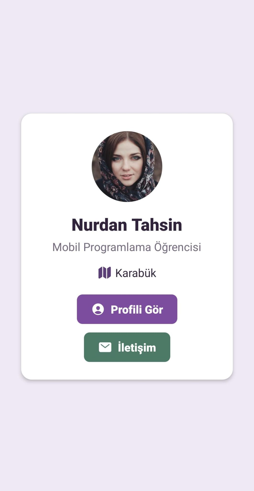

# Ödev 2 — Kişisel Tanıtım Kartı

Bu uygulama React Native bileşenlerini kullanarak kişisel bir tanıtım kartı oluşturur.

## Özellikler

- Profil görseli
- Ad-soyad ve bölüm bilgisi
- Konum bilgisi ve harita ikonu
- Profil görüntüleme butonu
- İletişim butonu
- Baskı durumunda buton geri bildirimi
- Konsola kullanıcıya ait özel mesaj yazdırma

## Kullanılan bileşenler

- `View`
- `Text`
- `Image`
- `Pressable`
- `Ionicons`
- `SafeAreaView`

## Ekran görüntüsü

Görsel portre ekran oranındadır ve README içinde 240 px genişlikte gösterilmiştir.

<p align="center">
  
</p>

## Çalıştırma

```bash
cd Odev2
npx expo start --clear
```

**Profili Gör** butonuna basıldığında profil mesajı konsola yazılır. **İletişim** butonuna basıldığında iletişim mesajı konsola yazılır.
