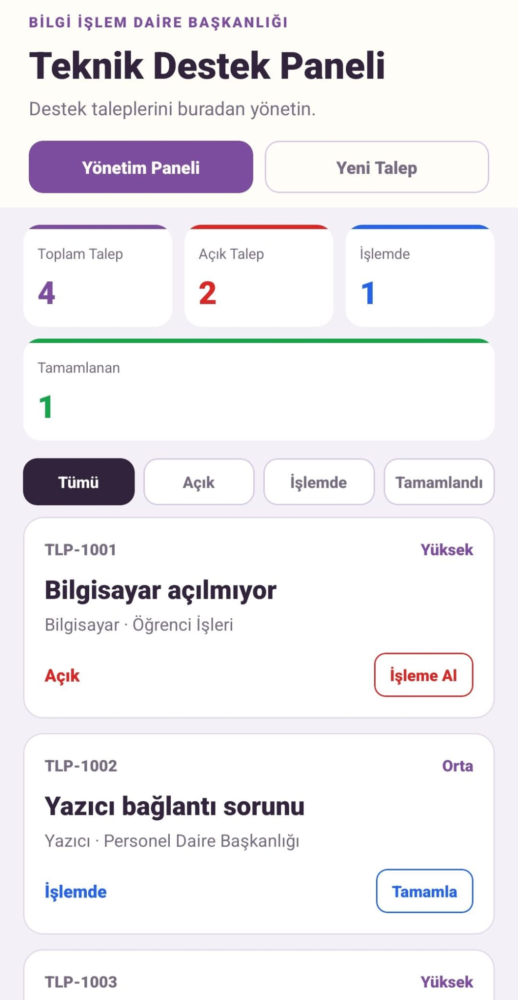
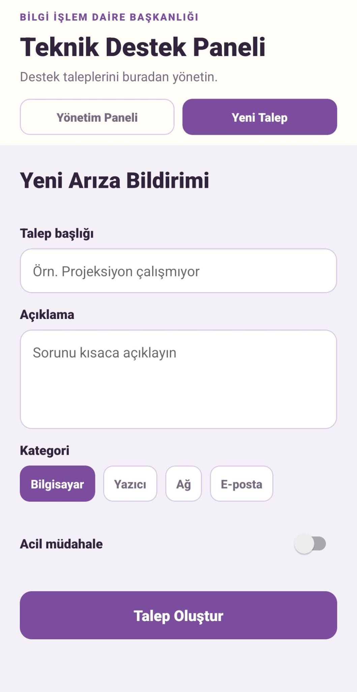

# Ödev 3 — Teknik Destek Yönetim Paneli

Bu uygulama, teknik destek taleplerini özetleyen, filtreleyen ve durumlarını yöneten React Native yönetim panelidir.

## Özellikler

- Yönetim paneli başlığı ve özet kartları
- Toplam, açık, işlemde ve tamamlanan talep sayıları
- Duruma göre talep filtreleme
- Talep kartlarında başlık, kategori, birim, öncelik ve durum
- Durum güncelleme işlemleri
- Yeni arıza talebi oluşturma formu
- En az 3 arıza kategorisi
- Başlık ve açıklama için doğrulama
- Acil müdahale anahtarı
- Ekran genişliği için duyarlı yerleşim

## Bileşenler ve teknikler

- `FlatList`
- `useState`
- `useMemo`
- `useWindowDimensions`
- `filter()` ve `map()`
- `SafeAreaView`
- Tekrar kullanılabilir talep kartı yerleşimi

## Ekran görüntüleri

Görseller portre ekran oranındadır ve README içinde 240 px genişlikte gösterilmiştir.

### Arıza Yönetim Paneli

<p align="center">
  
</p>

### Yeni Arıza Talebi

<p align="center">
  
</p>

## Çalıştırma

```bash
cd Odev3
npx expo start --clear
```

Panelde talep filtresi seçilebilir ve talep durumları sırayla Açık, İşlemde, Tamamlandı şeklinde güncellenebilir. Yeni talep sekmesinden kategori ve acil müdahale bilgisiyle kayıt oluşturulabilir.
