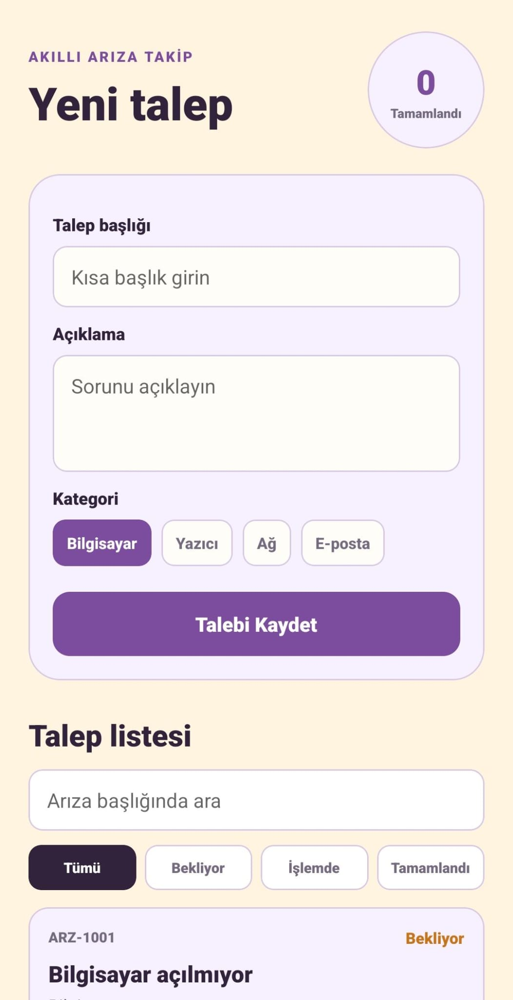
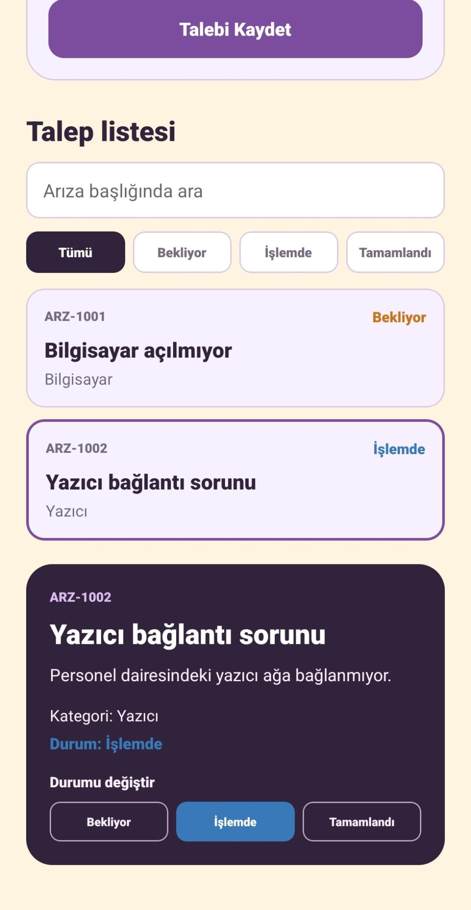
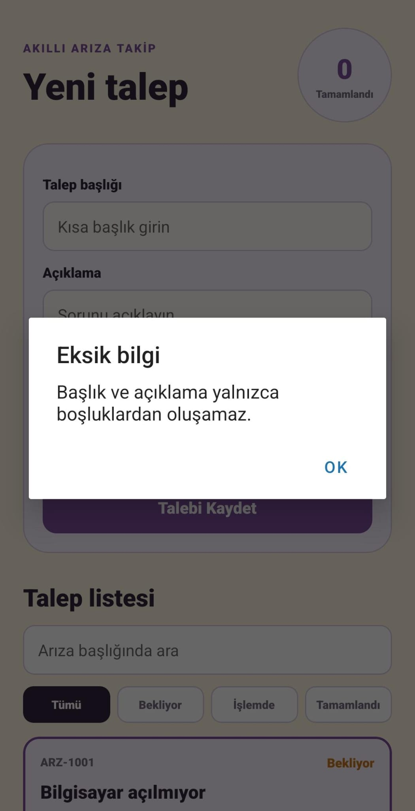

# Ödev 4 — Akıllı Arıza Talep Yönetimi

Bu uygulama, arıza talebi oluşturmayı, doğrulamayı, listelemeyi, detay göstermeyi, silme işlemini ve durum güncellemesini tek ekranda sunar.

## İşlevsel özellikler

- Talep başlığı ve açıklama alanı
- Bilgisayar, Yazıcı, Ağ ve E-posta kategorileri
- Boş veya yalnızca boşluk içeren alanların kayıt edilmesini engelleme
- Benzersiz arıza ID ile kayıt ekleme
- Kısa dokunuşla talep ayrıntısını gösterme
- Uzun basma ile silme onayı
- Vazgeçme veya onaylı silme seçenekleri
- Bekliyor, İşlemde ve Tamamlandı durumları
- Duruma ve başlığa göre liste filtreleme
- Anlık tamamlanan talep sayısı

## Ekran görüntüleri

Görseller portre ekran oranındadır ve README içinde 240 px genişlikte gösterilmiştir.

### Yeni Talep Formu

<p align="center">
  
</p>

### Talep Ayrıntısı

<p align="center">
  
</p>

### Eksik Bilgi Bildirimi

<p align="center">
  
</p>

### Silme Onayı

<p align="center">
  
</p>

## Özgün özellik

Yazılan arıza başlıklarını gerçek zamanlı ararken durum filtresiyle birleştiren arama özelliği eklenmiştir. Arama metni ve seçili durum, `useMemo` ile filtrelenen listeyi otomatik günceller.

## Çalıştırma

```bash
cd Odev4
npx expo start --clear
```
