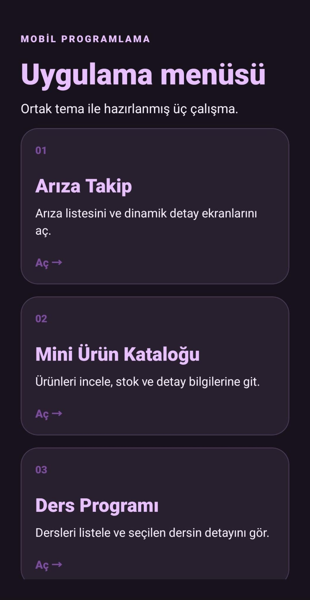
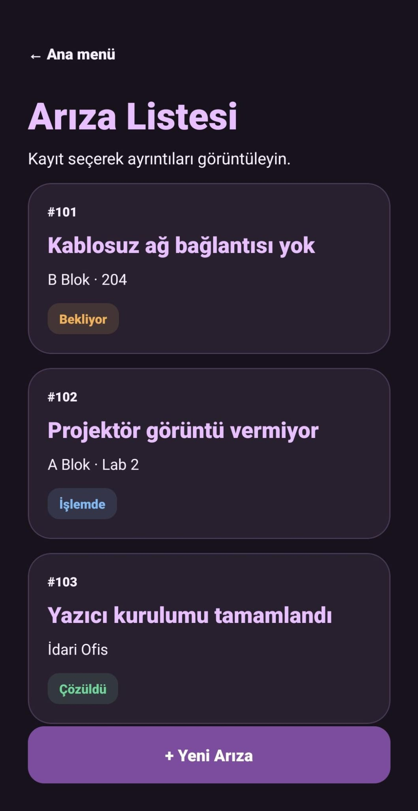
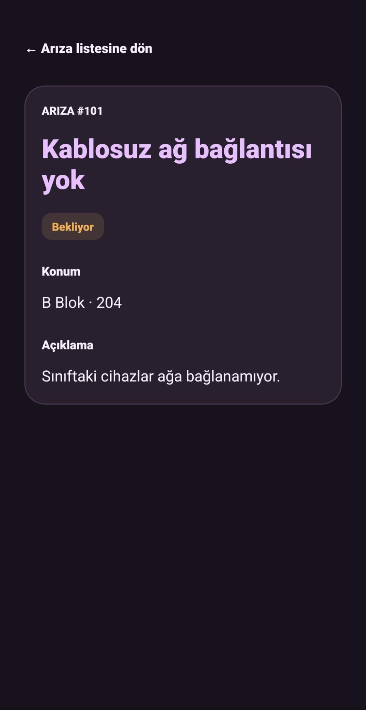
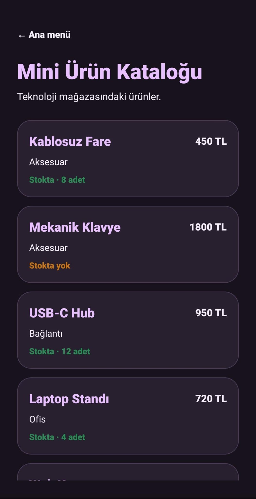
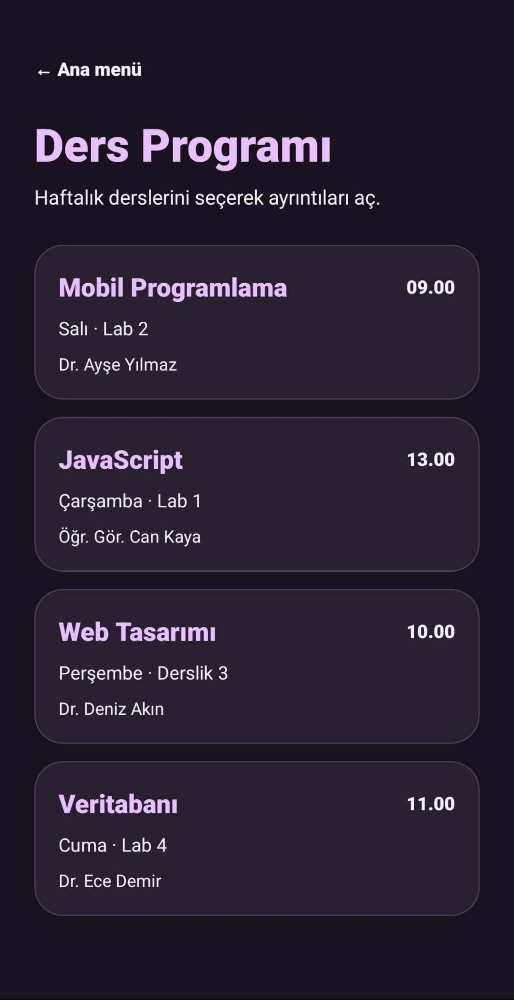
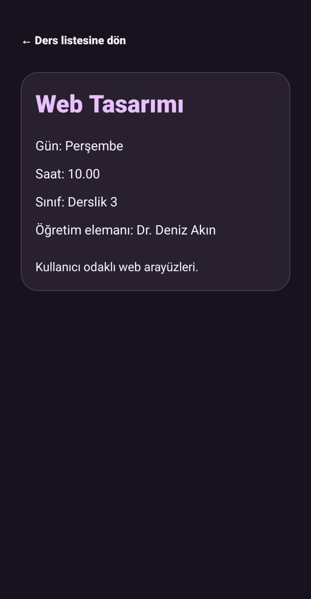

# Ödev 5 — Expo Router Uygulamaları

Föydeki üç senaryo aynı Expo Router projesinde, ortak mor-krem tema ve yeniden kullanılabilir bileşenlerle hazırlanmıştır.

## Uygulamalar

1. **Arıza Takip:** `/ariza` listesi, `/ariza/[id]` detay ekranı, üç durumlu `StatusBadge` ve `/ariza/yeni` rotası.
2. **Mini Ürün Kataloğu:** `/urun` listesi ve `/urun/[id]` detay ekranı. Beş ürün ve stok durumu bulunur.
3. **Ders Programı:** `/ders` listesi ve `/ders/[id]` detay ekranı. Dört ders ve hatalı ID mesajı bulunur.

Ana ekran (`/`) üç uygulamaya geçiş sağlar. Uygulamalar `TicketCard`, `ProductCard`, `CourseCard`, `ThemedCard` ve `ThemedText` bileşenlerini kullanır.

## Ekran görüntüleri

Görseller portre ekran oranındadır; README içinde düzenli görünmeleri için 240 px genişlikte gösterilmiştir.

### Ortak menü

<p align="center">
  
</p>

### Arıza Takip

<p align="center">
  
  
</p>

### Mini Ürün Kataloğu

<p align="center">
  
</p>

### Ders Programı

<p align="center">
  
  
</p>

## Çalıştırma

```bash
cd Odev5
npx expo start
```

Test için:

- Arıza listesinde `101` kaydını açın ve bilinmeyen bir ID deneyin.
- Ürünlerde `p2` kaydında **Stokta yok** yazısını kontrol edin.
- Ders listesinden farklı dersleri ve bilinmeyen ID davranışını kontrol edin.
- Telefonun açık/koyu temasını değiştirerek ortak temayı doğrulayın.
