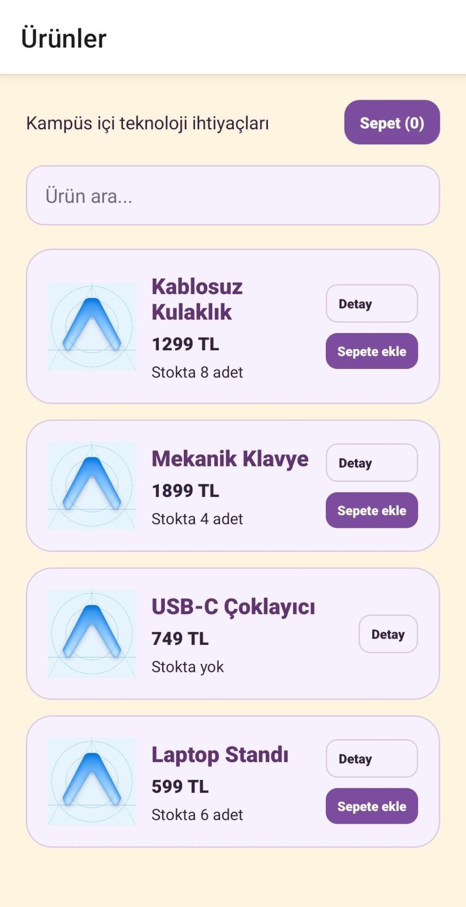
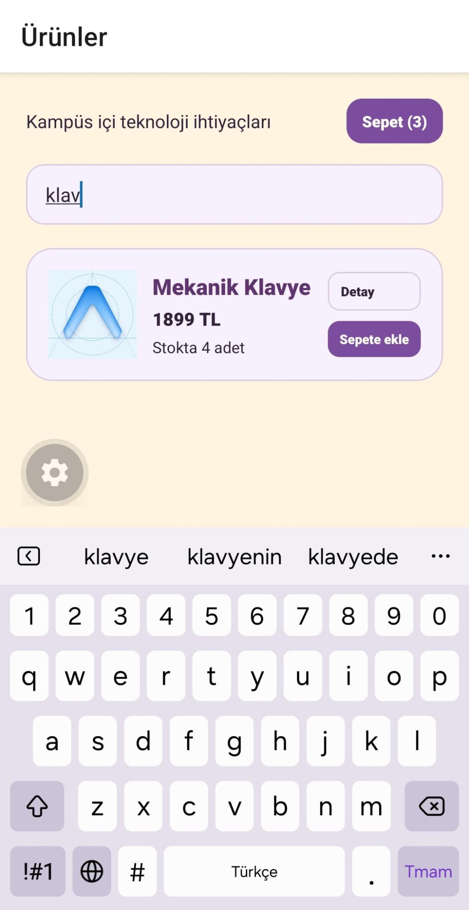
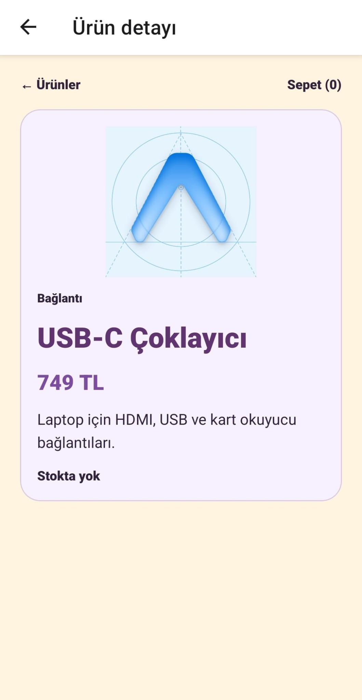
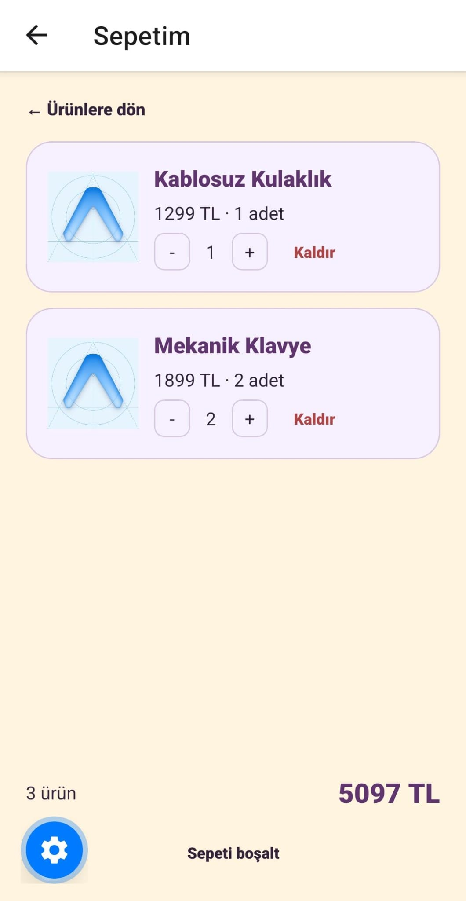

# Ödev 6 — Kampüs Market

Yerel ürün verileriyle çalışan, Expo Router ve Context API kullanan çok ekranlı alışveriş uygulaması.

## Özellikler

- Ürünleri görsel, ad, fiyat ve stok bilgisiyle listeleme
- Ada göre ürün arama
- `/urun/[id]` ile dinamik ürün detay ekranı
- Detay ekranında adet seçimi ve sepete ekleme
- Context API ile ortak sepet state'i
- Sepette adet artırma, azaltma, kaldırma ve sepeti boşaltma
- Stokta olmayan ürün için kontrollü durum
- Açık/koyu sistem temasına uyum

## Dosya yapısı

- `app/index.jsx` — ürün listesi ve arama
- `app/urun/[id].jsx` — ürün detayı
- `app/sepet.jsx` — sepet işlemleri
- `context/SepetContext.jsx` — ortak sepet state'i
- `data/urunler.js` — yerel ürünler
- `components/UrunKarti.jsx` — tekrar kullanılabilir ürün kartı
- `components/AdetSecici.jsx` — adet kontrolleri
- `components/SepetOzeti.jsx` — toplam adet ve tutar

## Ekran görüntüleri

Görseller portre ekran oranındadır; README içinde taşma olmaması için 240 px genişlikte gösterilmiştir.

### Ürün Listesi

<p align="center">
  
</p>

### Ürün Arama

<p align="center">
  
</p>

### Ürün Detayı

<p align="center">
  
</p>

### Sepet

<p align="center">
  
</p>

## Çalıştırma

```bash
cd Odev6
npx expo start --clear
```

Kontrol için ürün arayın, bir ürünü detaydan sepete ekleyin, `P103` stok durumunu inceleyin ve sepetten adet artırma/azaltma işlemlerini deneyin.
