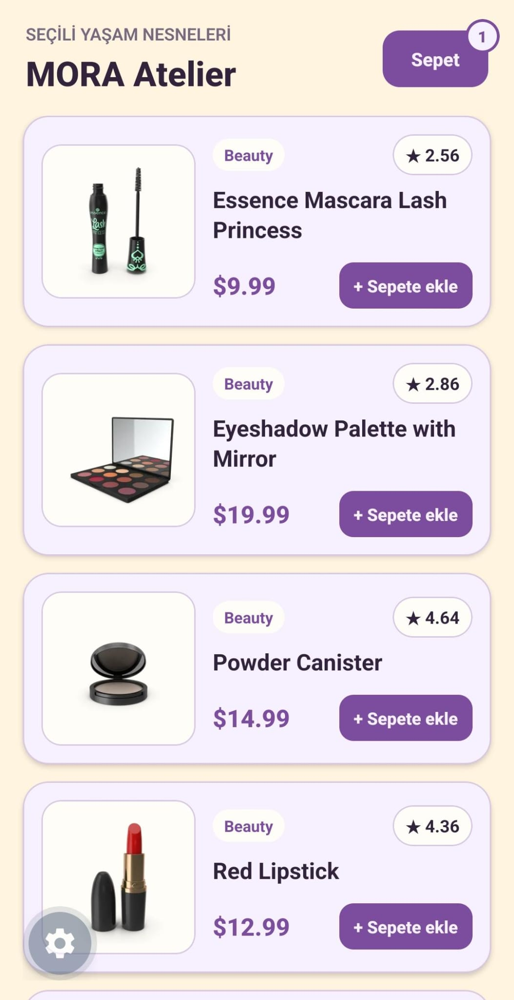
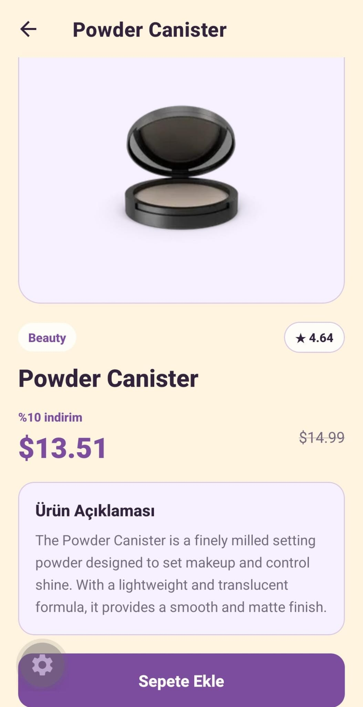
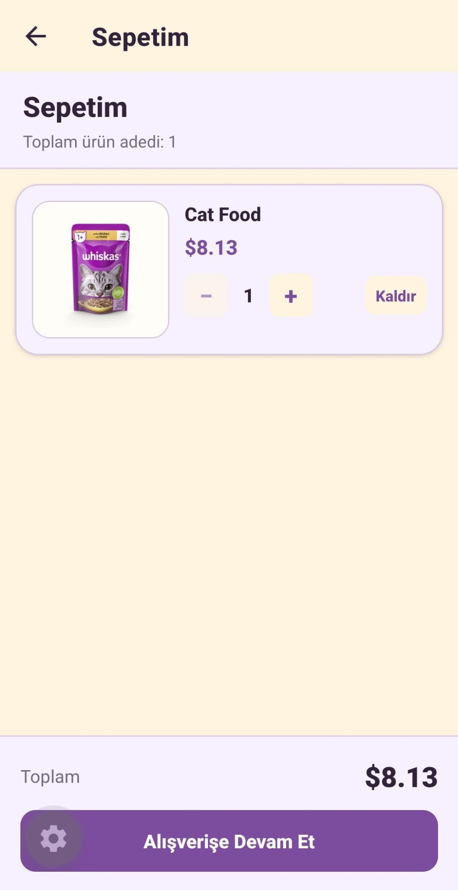
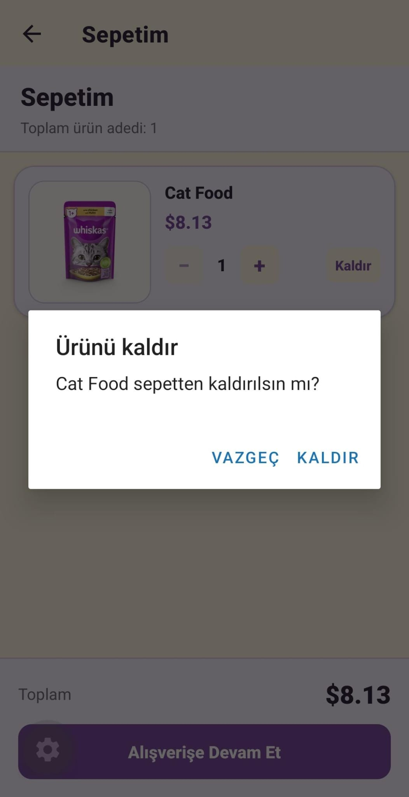

# Ödev 7 — MORA Atelier

DummyJSON Products API kullanılarak hazırlanmış, Expo Router ve Context API tabanlı yaşam nesneleri mağazası uygulaması.

## Özellikler

- Ürünlerin API üzerinden listelenmesi
- Dinamik ürün detay rotası
- Context API ile sepet yönetimi
- Ürün adedi artırma ve azaltma
- İndirimli sepet toplamı
- Mor-krem tema uyumu
- Loading, hata ve boş sepet durumları

## Çalıştırma

```bash
cd Odev7/eticaret-lab
npx expo start
```

## Sayfalar

- `app/index.js` — Ürün listesi
- `app/urun/[id].js` — Ürün detayları
- `app/sepet.js` — Sepet işlemleri
- `context/SepetContext.js` — Uygulama içi sepet durumu
- `components/UrunKarti.js` — Ürün kartı
- `constants/Colors.js` — Renk paleti

## Ekran Görüntüleri

### 1. Ürün Listesi

<p align="center">
  
</p>

### 2. Ürün Detayı

<p align="center">
  
</p>

### 3. Sepet

<p align="center">
  
</p>

### 4. Hata ve Uyarı Durumu

<p align="center">
  
</p>
