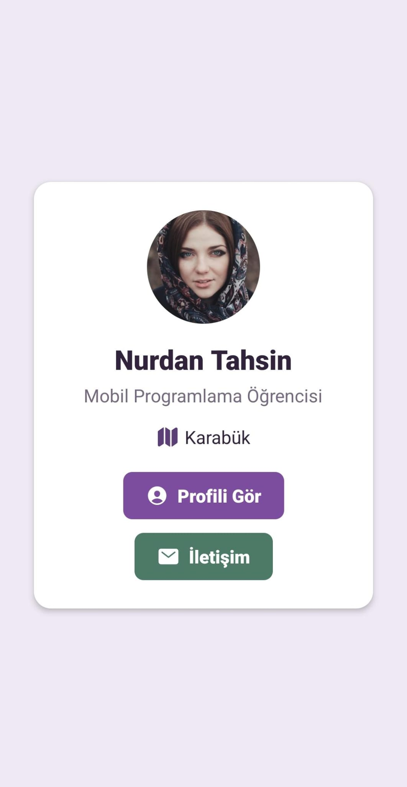
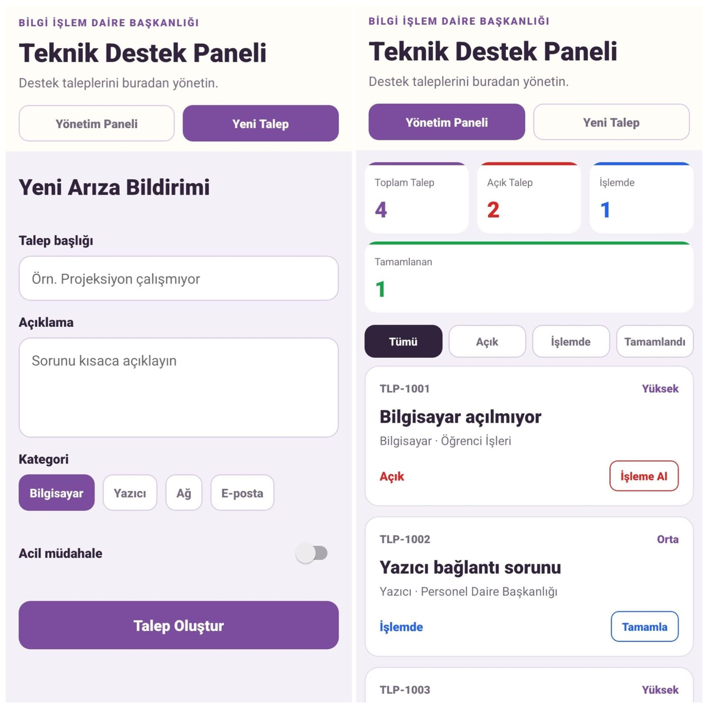
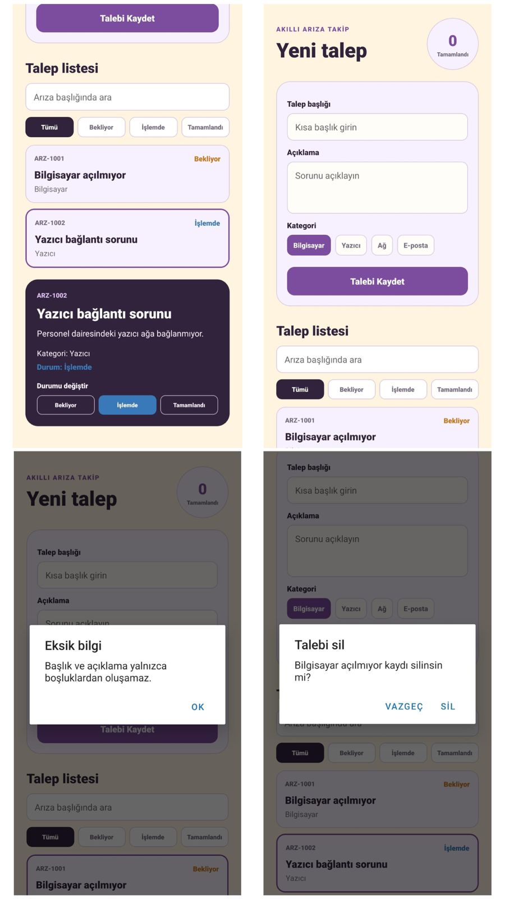
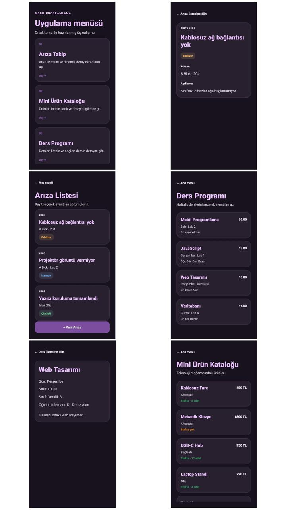
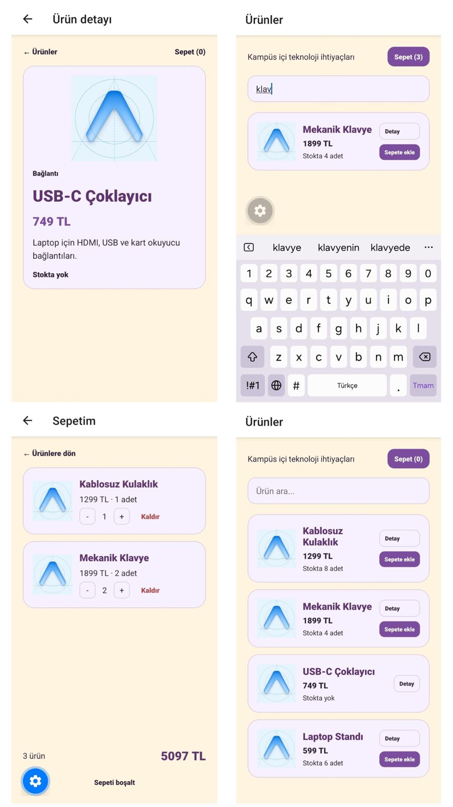
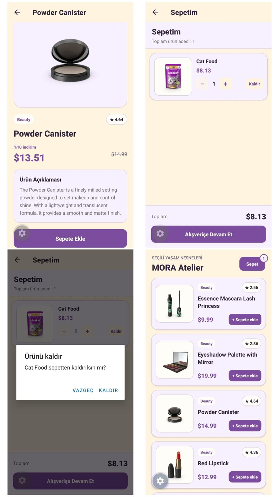

# Mobil Programlama Laboratuvarları

<p align="center">
  <strong>React Native · Expo · Expo Router · JavaScript</strong>
</p>

<p align="center">
  Bu depo, Mobil Programlama laboratuvarlarında hazırlanan 7 uygulamayı; öğretici örneklerden çok ekranlı mobil uygulamalara kadar tek bir çalışma alanında toplar.
</p>

---

## Hızlı Başlangıç

Her ödev bağımsız bir Expo projesidir.

```bash
cd Odev2
npx expo start --clear
```

Telefon veya emülatör üzerinde uygulama deneyimlerini inceleyebilir, farklı klasörlere geçerek ödevleri tek tek çalıştırabilirsiniz.

| Ödev | Uygulama | Ana Konular |
|---:|---|---|
| [1](./Odev1/README.md) | Mor Tema | Tema bileşeni, açık/koyu renkler |
| [2](./Odev2/README.md) | Kişisel Tanıtım Kartı | View, Text, Image, Pressable, Ionicons |
| [3](./Odev3/README.md) | Teknik Destek Yönetim Paneli | Flexbox, FlatList, filtreleme, state |
| [4](./Odev4/README.md) | Akıllı Arıza Talep Yönetimi | Form, doğrulama, uzun basma, silme |
| [5](./Odev5/README.md) | Expo Router Uygulamaları | Üç ekran akışı, dinamik rota, bileşenler |
| [6](./Odev6/README.md) | Kampüs Market | Arama, ürün detayı, Context API sepet |
| [7](./Odev7/eticaret-lab/README.md) | MORA Atelier | Ürün API’si, dinamik rota, sepet yönetimi |

---

## Ortak Tasarım Sistemi

Projelerde lila, krem ve açık mor renklerden oluşan tutarlı bir mobil arayüz dili kullanılmıştır.

| Kullanım | Renk |
|---|---|
| Ana zemin | `#FFF4DF` |
| Kart yüzeyi | `#F7F1FF` |
| Ana metin | `#30233B` |
| Yardımcı metin | `#766A80` |
| Başlık/temalı vurgu | `#60356F` |
| Birincil mor | `#7C4D9E` |
| Kenarlık | `#D8C8E5` |

Ortak yaklaşım; okunabilir kontrast, yumuşak köşe kenarları, küçük etiketler, güçlü başlık hiyerarşisi ve yeniden kullanılabilir bileşenlerden oluşur.

---

# Ödev 2 — Kişisel Tanıtım Kartı

**Klasör:** [Odev2](./Odev2)

Profil görseli, ad-soyad, bölüm, konum, kişisel profil ve iletişim etkileşimlerini tek bir tanıtım kartında birleştirir.

### Öne çıkan özellikler

- `View`, `Text`, `Image` ve `Pressable` bileşenleri
- Konum ve profil ikonları
- İki ayrı buton geri bildirimi
- Kişiselleştirilmiş profil tasarımı
- Konsola özel kullanıcı mesajları

### Ekran görüntüsü

<p align="center">
  
</p>

[Odev 2 README](./Odev2/README.md) · [Kaynak kod](./Odev2/app/index.jsx)

---

# Ödev 3 — Teknik Destek Yönetim Paneli

**Klasör:** [Odev3](./Odev3)

İki laboratuvar senaryosunu birleştiren yönetim paneli; destek taleplerini özetler, filtreler ve güncel durumlarla birlikte listeler.

### Öne çıkan özellikler

- Toplam, açık, işlemde ve tamamlanan talepler
- `FlatList` ile kaydırılabilir talep listesi
- Duruma göre filtreleme
- Yeni arıza talebi formu
- Kategori ve acil müdahale seçenekleri
- Talep durumunu anında değiştirme
- `useState`, `useMemo` ve `useWindowDimensions`

### Ekran görüntüsü

<p align="center">
  
</p>

[Odev 3 README](./Odev3/README.md) · [Kaynak kod](./Odev3/app/index.jsx)

---

# Ödev 4 — Akıllı Arıza Talep Yönetimi

**Klasör:** [Odev4](./Odev4)

Arıza kayıtlarını oluşturan, doğrulayan, arayan, filtreleyen, görüntüleyen, silen ve durumlandıran etkileşim odaklı uygulama.

### Öne çıkan özellikler

- Başlık ve açıklama doğrulaması
- En az dört arıza kategorisi
- Benzersiz talep kimliği
- Kısa dokunuşla talep ayrıntısı
- Uzun basma ile silme onayı
- Bekliyor, İşlemde ve Tamamlandı durumları
- Başlık arama ve durum filtresi
- Tamamlanan talep sayısının anlık hesaplanması

### Ekran görüntüsü

<p align="center">
  
</p>

[Odev 4 README](./Odev4/README.md) · [Kaynak kod](./Odev4/app/index.jsx)

---

# Ödev 5 — Expo Router Uygulamaları

**Klasör:** [Odev5](./Odev5)

Hafta 5 föyünün üç ayrı senaryosunu tek projede birleştirir: Arıza Takip, Mini Ürün Kataloğu ve Ders Programı.

### Öne çıkan özellikler

- Ortak ana menü
- Expo Router geçişleri
- Dinamik `/ariza/[id]`, `/urun/[id]` ve `/ders/[id]` rotaları
- `FlatList` ile veri listeleri
- `StatusBadge`, `TicketCard`, `ProductCard` ve `CourseCard`
- Hatali kimlikler için kontrollü boş ekranları
- Açık/koyu tema uyumu

### Ekran görüntüsü

<p align="center">
  
</p>

[Odev 5 README](./Odev5/README.md) · [Uygulama menüsü](./Odev5/app/index.jsx)

---

# Ödev 6 — Kampüs Market

**Klasör:** [Odev6](./Odev6)

Yerel ürün verileriyle çalışan; arama, ürün detay, adet seçimi ve ortak sepet state’i sağlayan Kampüs Market uygulaması.

### Öne çıkan özellikler

- Ürün arama
- Görsel, fiyat, açıklama ve stok bilgisi
- Dinamik ürün detay rotası
- Adet artırma ve azaltma
- Context API tabanlı sepet
- Ürün kaldırma ve sepeti boşaltma
- Toplam adet ve tutar hesaplama
- Stokta olmayan ürün durumunun kontrolü

### Ekran görüntüsü

<p align="center">
  
</p>

[Odev 6 README](./Odev6/README.md) · [Ürün listesi](./Odev6/app/index.jsx)

---

# Ödev 7 — MORA Atelier

**Klasör:** [Odev7/eticaret-lab](./Odev7/eticaret-lab)

DummyJSON Products API üzerinden ürünleri getiren, ürün detaylarını gösteren ve Context API ile sepet işlemlerini yöneten e-ticaret uygulaması.

### Öne çıkan özellikler

- Ürün listesi ve API veri çekme
- Dinamik ürün detay sayfası
- Loading, hata ve boş veriler
- Ortak sepet bağlamı
- Adet artırma ve azaltma
- Ürün kaldırma onayı
- Indirimli sepet toplamı
- Çoklu ekran ve geri gezinme

### Ekran görüntüsü

<p align="center">
  
</p>

[Odev 7 README](./Odev7/eticaret-lab/README.md) · [Ürün listesi](./Odev7/eticaret-lab/app/index.js)

---

# Ödev 1 — Mor Tema

**Klasör:** [Odev1](./Odev1)

React Native’ın açık ve koyu temasını algılayan temel tema bileşeni örneği. `ThemedView`, tema renklendirme ve cihaz temasına göre arka plan uyumunu gösterir.

[Odev 1 README](./Odev1/README.md) · [Kaynak kod](./Odev1/app/index.jsx)

---

## Uygulamaları Çalıştırma

Örneğin Ödev 6’yı çalıştırmak için:

```bash
cd Odev6
npx expo start --clear
```

Diğer projeler aynı yapıda çalıştırılır:

```bash
cd Odev2  # veya Odev3, Odev4, Odev5, Odev7/eticaret-lab
npx expo start --clear
```

## Kullanılan Teknolojiler

- React Native
- Expo
- Expo Router
- React Context API
- Safe Area Context
- Ionicons
- FlatList ve TextInput
- DummyJSON Products API
